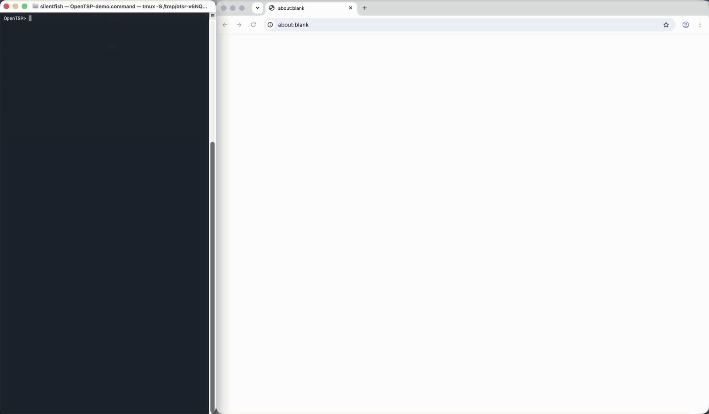

# OpenTSP

OpenTSP is an open-source initiative to build and explore architectures inspired by the Tensor Streaming Processor (TSP). We’re building a workflow that connects formal modeling, fast software simulation, and rapid FPGA prototyping so more people can experiment with how machine-learning accelerators work.

Our goal is to make accelerator architecture something anyone can test, challenge, and improve. An executable model gives architects and RTL designers a shared reference for how the machine should behave. Cycle-aware simulation lets compiler developers run real workloads and see where a schedule leaves compute idle. FPGA prototypes will let us test those ideas on hardware and use what we learn to improve the architecture.

## Project roadmap

Version 0.1 gives you an executable architecture, tools to program it, and a fast simulator for running real workloads and inspecting their results and timing.

| Workstream | Available today in 0.1 | Next |
|---|---|---|
| [Architecture and formal model](opentsp-arch-spec/README.md) | Architecture specification, executable Sail semantics, profiles, reference C harness, instruction catalogue, and conformance vectors | Use the model to compare architecture variants and validate hardware prototypes. |
| [Formal verification](docs/assurance.md) | Component proofs, differential checks, and regression tests | **In progress.** Build a machine-checked correctness theorem for the complete Sail model across all admitted executions. |
| [Software toolchain](opentsp-sw-toolchain/README.md) | Assembler, ELF objects, Safetensors weights, multi-chip manifests, and Schedule Explorer | Develop a compiler for mapping models to scheduled TSP programs, a debugger for tracing incorrect results, and a profiler for finding underused resources. Explore domain-specific languages (DSLs) for streaming computation and scheduling. |
| [Software simulation](opentsp-iss/README.md) | Cycle-aware Rust instruction-set simulator with diagnostics, traces, and activity reports | Improve simulation throughput to let developers iterate on larger workloads and more architecture variants. |
| [Inference-engine integration](opentsp-vllm/README.md) | A working vLLM bridge with TinyStories on one simulated chip and GPT-2 small on four | Explore how runtime batching, KV-cache allocation, and prefix reuse can work with statically scheduled multi-chip pipelines. |
| FPGA prototyping | Sail reference model and conformance vectors for checking RTL behavior | OpenTSP FPGA RTL will be released soon. Use rapid prototyping to compare the hardware with the model. |

## Architecture inspiration

OpenTSP is inspired by Groq's original Tensor Streaming Processor papers.
The 2020 paper introduces the functionally sliced processor. The 2022 paper describes how TSPs communicate and scale as a multiprocessor. OpenTSP is an independent specification and implementation.

- Dennis Abts et al., [*Think Fast: A Tensor Streaming Processor (TSP) for Accelerating Deep Learning Workloads*](https://doi.org/10.1109/ISCA45697.2020.00023), ISCA 2020.
- Dennis Abts, Garrin Kimmell, Andrew Ling, et al., [*A Software-defined Tensor Streaming Multiprocessor for Large-scale Machine Learning*](https://doi.org/10.1145/3470496.3527405), ISCA 2022.

## Four-chip GPT-2 demo

Bringing a TSP into a modern inference engine is an open design problem in its own right. Engines like vLLM admit requests and allocate KV-cache pages at runtime, while TSP programs schedule computation and data movement in advance. How can the two work together to keep chips busy as requests arrive, reuse cached prefixes, and share a pipeline? OpenTSP takes a first step with a working vLLM bridge for GPT-2 small. vLLM manages requests, KV-cache allocation, and token sampling, while compiled TSP programs execute the transformer and vocabulary projection across four simulated chips. [Four-chip design](docs/gpt2-four-chip-design.md)

The live browser demo uses four simulated chips. Run eight users and watch each prompt and answer as it streams. The execution strip follows the same users through batching and through the four chips. Build the sealed program bundle from the included four-chip schedules and the upstream checkpoint. [Set up and launch the four-chip demo](docs/demos.md#gpt-2-setup).

[Watch the 11-second screencast](docs/media/gpt2-four-chip.mp4). Terminal.app starts vLLM and the demo with `just gpt2-demo`. Chrome shows the same live eight-user run, including four-chip handoffs, streamed output and software and projected silicon throughput. Startup plays at 8×. Inference plays at its original speed. The startup log shows the checkpoint path used for the recording. For the current bundle-based startup, follow the demo guide above.

### System throughput

One run of GPT-2 small on four simulated TSP chips at a maximum batch size of eight. The ISS was configured with four CPU worker threads on an Apple M5 Max. The run generated 48 output tokens. [Demo specifics](docs/demos.md#four-chip-gpt-2-small)

| Execution | Output tokens/s, total | Output tokens/s per user |
|---|---:|---:|
| Software ISS, measured | 8.16 | 1.02 |
| Projected TSP silicon at 900 MHz | 24,505.87 | 3,063.23 |

Software throughput uses browser wall time after startup. The silicon projection uses observed simulator cycles and excludes host overhead.

## Install and build

Follow [installation](docs/installation.md) for native macOS, native Linux or the Ubuntu development container, including the pinned Sail, Rust, Python and optional Lean/serving prerequisites. Run commands from this directory.

~~~bash
source "${OPENTSP_TOOLCHAIN:-$HOME/.local/opt/opentsp-toolchain}/env.sh"
just python-setup
cargo build --release --workspace
opentsp-arch-spec/tools/build_sim.sh
~~~

The executables are target/release/ots-asm, target/release/tsp-iss and target/spec/tsp_sim. The [assembly example](opentsp-arch-spec/docs/assembly.md#3-program-files-ots) adds two input vectors and writes the result to SRAM. Build and run the documented example with:

~~~bash
bash opentsp-sw-toolchain/tests/e2e_example.sh "$PWD/target/release/ots-asm" "$PWD/target/spec/tsp_sim"
~~~

For your own program:

~~~bash
target/release/ots-asm asm -o /tmp/program.elf program.ots
target/release/tsp-iss run --profile ref --trace /tmp/program.elf
~~~

Pass external `.safetensors` weight packages with `--weights`. The assembler exits 1 for a coded diagnostic and 2 for a usage error. Ctrl-C interrupts a foreground command; service shutdown is covered in the [demo guide](docs/demos.md).

## Documentation

- [Install and build](docs/installation.md) on macOS, Linux or in an Ubuntu container.
- [Run the demos](docs/demos.md) for four-chip GPT-2 and single-chip TinyStories, including HTTP usage and the serving package layout.
- [Write and inspect programs](opentsp-sw-toolchain/README.md) with the assembler, kernel cookbook and Schedule Explorer.
- [Choose a test suite](docs/testing.md) by the behavior you need to check. The [assurance notes](docs/assurance.md) explain the coverage and its limits.

## License

OpenTSP uses the [Apache 2.0 license](LICENSE-APACHE-2.0). Architecture sources and implementation rationale are listed in the [provenance catalogue](opentsp-arch-spec/isa-db/provenance.yaml).
