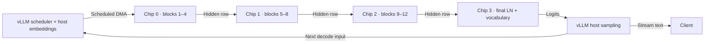

# Four-chip GPT-2 design

OpenTSP runs GPT-2 small as a pipeline on four simulated TSP chips. vLLM owns request scheduling, tokenization, prefix-cache allocation, and sampling. The compiled chip programs execute the transformer, keep each layer's K and V in local SRAM, and return vocabulary logits to vLLM. The [demo guide](demos.md#four-chip-gpt-2-small) covers building and running it.

## Model placement

The checkpoint has 124,439,808 unique parameters. There are 12 transformer blocks, 12 attention heads of dimension 64 per block, a hidden width of 768, a feed-forward width of 3,072, and a vocabulary of 50,257. The position embedding table has 1,024 rows. The demo's resident KV layout limits the serving context to 256 positions and shares those positions across live requests.

| Where | Work for one scheduled token row | Persistent data |
|---|---|---|
| Host ingress | Tokenize, choose the next scheduled position, add token and learned position embeddings, prepare KV controls | Tokenizer, shared model embeddings, vLLM request state and block tables |
| Chip 0 | Transformer blocks 1–4 | Four blocks' coefficients and KV |
| Chip 1 | Transformer blocks 5–8 | Four blocks' coefficients and KV |
| Chip 2 | Transformer blocks 9–12 | Four blocks' coefficients and KV |
| Chip 3 | Final layer normalization and projection over the whole vocabulary | Final normalization coefficients and the tied token-embedding matrix in MXM layout |
| Host egress | Reassemble FP32 logits, select the rows to sample, apply the vLLM sampler and stream text | Sampling metadata and per-request RNG state |

The partition is contiguous in depth. Each transformer chip owns the recurrent state for its four layers. A chip boundary carries a hidden row. K and V stay on the chip that produced them. Chip 3 holds the complete vocabulary projection. This is a point-to-point pipeline inside one vLLM backend, with one simulated system and one scheduler. vLLM's tensor and pipeline parallel sizes are both one.

### Tensor lowering

The [checkpoint loader](../opentsp-vllm/src/opentsp_vllm/models/gpt2/weights.py) reads the safetensors file, transposes GPT-2's Conv1D weights from input-by-output to output-by-input, and splits the fused QKV matrix and bias in Q, K, V order. [The layer adapter](../opentsp-vllm/src/opentsp_vllm/models/gpt2/system.py) stacks the three matrices and biases in that same order for the scheduled projection. Matrix and embedding coefficients use FP16. Biases and normalization scale/shift vectors use FP32. The tied vocabulary projection uses the same converted token-embedding values the host reads for embedding. The host casts the two selected embedding rows to FP32 before addition.

| Scheduled matrix | Logical shape, output × input | Per-chip use |
|---|---:|---|
| QKV | 2,304 × 768 | One per transformer block |
| Attention output | 768 × 768 | One per transformer block |
| FFN expansion | 3,072 × 768 | One per transformer block |
| FFN contraction | 768 × 3,072 | One per transformer block |
| Vocabulary | 50,257 × 768 | Once on chip 3, padded to 50,304 output rows |

The hidden row is six tiles of 128 values. Each tile covers two attention heads. The host sends four FP32 byte planes per tile through chip 0 ingress, 24 vectors per row. Stage Send and Receive instructions carry activations along the configured 0→1→2→3 links, and PciSend returns the vocabulary output. The vocabulary stage covers 393 tiles. The host discards the 47 padding logits before sampling. In the single-page paired program, vocabulary egress packs up to two 128-lane tiles per four-plane group and interleaves the paired rows within each 24-tile window. The host uses the sealed layout to deinterleave them.

### One transformer block

1. Normalize the incoming hidden row and apply the QKV projection with bias. The matrix path tiles coefficients for MXM and uses the vector unit for arithmetic around that operation.
2. Convert the new K and V to FP16. MEM scatter writes them to the resident slot specified by the host's address controls.
3. Form scaled query-key scores and mask the unowned or not-yet-visible slots. Softmax combines valid scores per head. Multiply by resident V rows and sum to obtain context. Attention uses matrix, vector, stream-permutation and memory operations. The single-page paired program specializes the QK path for the selected physical page.
4. Project attention output, add the residual and normalize again. Run the expansion, GELU and contraction, then add the second residual.
5. Keep the result on chip for the next local block or send it across the next stage link.

The [layer](../opentsp-vllm/src/opentsp_vllm/models/gpt2/layer.py) and [attention](../opentsp-vllm/src/opentsp_vllm/models/gpt2/attention.py) implementations show the underlying operation sequences. The shipped schedule archive fixes the concrete instruction order, placement, overlaps and paging of each specialized variant. The sealed schedules govern the exact issued instructions and arithmetic order.

## From model to executable bundle

### Scheduled lowering and placement

The compiled programs start from the model-specific partition above. Each stage lowers its normalization, matrix, attention and FFN operations to TSP instructions. It assigns output tiles, allocates SRAM rows for packed coefficients, scratch, KV, and instruction text, and arranges stream and instruction-queue use at specified cycles. The stage schedules include ingress and egress times so one chip's sends meet the next chip's receives. Work exceeding the initial IQ image uses SRAM instruction parcels and scheduled Ifetch or IfetchM. The [paging implementation](../opentsp-sw-toolchain/python/opentsp_tools/pager.py) documents how ready times, resource conflicts and fetch deadlines constrain those parcels.

The released archive, [gpt2-program-sources.zip](../opentsp-vllm/demo/gpt2-program-sources.zip), is already lowered. For each variant and chip it contains schedule.json with encoded initial queue words, extern destinations and a preload recipe, plus constants.bin with the literal preload bytes, runtime bindings and expected file digests. The archive and checkpoint together reproduce this exact route. Changes to layer placement, precision, supported shapes or instruction timing require newly lowered and qualified schedules. The release provides the sealed GPT-2 rebuild path and reusable kernel and paging components.

For example, the first block on chip 0 uses 18 QKV output tiles by three inner tiles, for 54 coefficient tiles. Each tile's 64 KiB of FP16 coefficients is serialized into 256 physical words occupying 80 KiB. The full variant's schedule includes an extent named `l0wqkv_0_200` with 432 of those words at slice 0, address `0x200`. The preload recipe associates that extent with named bands of the first local block's QKV matrix. The assembler records the destination. At runtime the compiled memory and MXM instructions read the corresponding tiled coefficients and accumulate over the three inner tiles before the bias is applied.

### Public rebuild and file contracts

[The public builder](../opentsp-vllm/tools/build_gpt2_programs.py) implements `just gpt2-programs` in this order.

1. Verify the source archive hash and load the expected checkpoint. Verify the digest of the converted model tensors.
2. Save the logical parameters as one `weights.safetensors` file. The embedding matrix is stored once and serves both host embeddings and chip 3's tied vocabulary head. Copy the vLLM config and tokenizer alongside it.
3. Encode each stage's queue images, extern table, fetched parcels, literal ranges, zero events and matrix/vector recipes in ELF32. Digest the decoded sections and seal the metadata and bindings. Keep a separate checksum of the exact file read by the loader.
4. On deployment, resolve each recipe from the shared tensors. A 128×256 FP16 matrix tile uses sixteen bands of byte-plane words. A 320-byte SRAM word carries 256 coefficient bytes and 64 padding bytes. Biases and normalization vectors become placed FP32 planes. Stage variants reuse identical materialized runs in memory. The optional verified cache supplies those physical bytes without repacking.
5. Publish the complete bundle atomically. The runtime uses the bundle's config and shared logical tensors, including for the numerical twin.

| File in a built bundle | Contract |
|---|---|
| `weights.safetensors` | Shared logical tensors including embeddings and tied head weights. |
| `model/` | vLLM config and tokenizer files. |
| `<variant>/manifest.json` | Pins the profile, logical weight identity, route and semantic identity of four stage descriptors. |
| `<variant>/sN/program.elf` | Resolved queue images, extern addresses, text pages, literals, zero events and the tensor recipe. |
| `<variant>/sN/bindings.npz` | Scheduled host DMA offsets and page-dependent operand sites and fetch blocks. |
| `<variant>/sN/program.json` | Stage identity, cycle budget, any output packing parameters and payload digests. |

The [assembler reference](../opentsp-arch-spec/docs/assembly.md) specifies the ELF and raw SRAM formats. The public rebuild and optional prebuilt image commands are in the [demo guide](demos.md#gpt-2-setup).

## KV residency and variant selection

vLLM assigns 16-position blocks. Block 0 is the null block. For token position `p`, block ID `b` comes from the request's block table at `p // 16`. Its physical slot is `(b - 1) * 16 + p % 16`. The same block/slot mapping applies to all 12 layers. Each row carries the visible count for every physical page, from zero through 16, including the row being appended. This represents causal order even when allocator page IDs are scattered. Two requests that share a cached prefix can reference the same resident pages. A later write still follows the scheduler's ownership and the row's append slot. The [step planner](../opentsp-vllm/src/opentsp_vllm/ship_plan.py) validates the tables and builds the slot and mask arrays.

The sealed layout has 16 usable pages, in two chunks of eight pages. For local layer index `i` on chips 0–2, K starts at word `0x1400 + 0x100*i` across 16 slices. V starts at word `0x100 + 0x100*i` in 12 slice extents. FP16 K stripes match the matrix path. V uses byte-plane rows organized for the scheduled context computation. The exact slice assignment is in the stage extern table. Each four-block chip has 7.5 MiB of physical KV payload. Across the three chips, 9 MiB of logical FP16 K and V occupy 22.5 MiB in the scheduled word layout. Weights and the same addressable KV layout are shared across program variants on the running simulator.

All rows in a scheduler step use one selected variant. The [selector](../opentsp-vllm/src/opentsp_vllm/models/gpt2/four_chip_packages.py) applies these tests in order.

| Variant | Admission and issue shape |
|---|---|
| `full` | Any row writes above slot 127, has no visible first-chunk page, or has a visible second-chunk page. Issue single rows using the two-chunk schedule. |
| `single-page-pair` | Exactly eight rows. Each row appends within its sole visible first-chunk page, and all eight pages are distinct. Issue four pairs. |
| `single-page` | The same single-visible-page and distinct-page condition for a smaller step. Issue single rows. |
| `paired` | Exactly eight rows with distinct first-chunk destination pages, where at least one row fails the single-visible-page condition. Issue four pairs with first-chunk attention. |
| `sparse` | Other first-chunk-only batches. Issue single rows with first-chunk attention. |

For a single-page route, the host uses the sealed operand bindings to specialize the affected initial IQ and fetched instruction words to the actual KV page IDs. It computes a delta at 320-byte word granularity. A changed word can be written after the preceding stage group drains and must arrive before the next fetch. The transfer check includes the host vector cadence. If it cannot fit, use the ordinary sparse or paired path. This changes instruction operands while preserving the schedule envelope. The KV data stays at the allocator's physical slot. See [page binding and transfer admission](../opentsp-vllm/src/opentsp_vllm/models/gpt2/four_chip_pages.py).

## From a vLLM step to a streamed token

1. The [launcher](../opentsp-vllm/src/opentsp_vllm/serve.py) activates the OpenTSP [vLLM platform plugin](../opentsp-vllm/src/opentsp_vllm/platform.py) and validates the deployment directory and its sealed manifests and checks the requested limits. It gives vLLM the bundled config and tokenizer and gives the worker the shared `weights.safetensors`. The HTTP launcher defaults to four sequences. The browser demo uses eight. Both allow eight scheduled token rows per step.
2. The backend configures the synchronous vLLM V1 scheduler and the [TSP worker](../opentsp-vllm/src/opentsp_vllm/worker.py). The worker advertises a full-attention cache specification for each layer so vLLM manages allocator state. The simulated SRAM provides the storage. Startup checks the compiled profiles, package digests and resident layout equality across variants.
3. vLLM can issue prompt chunks and decode rows in one SchedulerOutput. The [model runner](../opentsp-vllm/src/opentsp_vllm/model_runner.py) updates request state, handles new-block zeroing and translates scheduled positions into a step plan. For a prefix hit, the scheduler starts after the positions it credits as cached. Those positions do not enter the pipeline again. On this route a copy to a different physical KV block is unsupported and raises an error. Shared-prefix reads reuse the same allocated page directly.
4. [ShipChip](../opentsp-vllm/src/opentsp_vllm/ship_chip.py) passes token IDs, positions, append slots and visibility counts to the [resident pipeline](../opentsp-vllm/src/opentsp_vllm/models/gpt2/four_chip.py). On the first launch it installs the selected stage contents. Subsequent launches reuse the simulator and keep resident matrices and KV in place. Variant switches load the selected instruction and other nonresident data. The [execution driver](../opentsp-vllm/src/opentsp_vllm/models/gpt2/four_chip_execution.py) feeds the initial and repeat IQ segments, schedules host DMA and applies per-row controls at stage boundaries. Linked ISS execution is guarded and can fall back to ordinary shared-clock simulation.
5. The stages overlap work from different groups. In the qualified single-page paired schedule, the steady-state repeat cadence is 30,534 simulated cycles per pair. First-result latency also includes pipeline fill. For a given user, prefill advances prompt KV through all three transformer stages. Sampling after the final scheduled prompt row yields the first generated token. A later step feeds that token back as the next decode input. Each further decode appends KV at its next position and advances through the same four chips. Other users' rows can move concurrently.
6. After execution and completion checks, the driver reassembles FP32 logits in row order. The current program computes a vocabulary result for each issued row. The worker returns logits to the CPU sampler only for a request's last known token reached in that step. A mid-prefill row updates KV and emits no new token. The sampler applies per-request sampling metadata, updates request state and returns token IDs to vLLM for detokenization and streaming.
7. The [demo interface](demos.md#four-chip-browser-demo) correlates actual scheduler steps, observed chip arrivals, sampler results and streamed tokens. With `--tsp-check`, the chip wrapper also compares computed logits with the numerical twin bit for bit. The [RAS contract](../opentsp-arch-spec/docs/production-ras.md) defines completion checks, fault containment and recovery. The documented [assurance limits](assurance.md) apply.

Any silicon estimate derived from simulated cycles excludes host API, embedding, scheduling, transfer control, sampling and simulator wall time.
